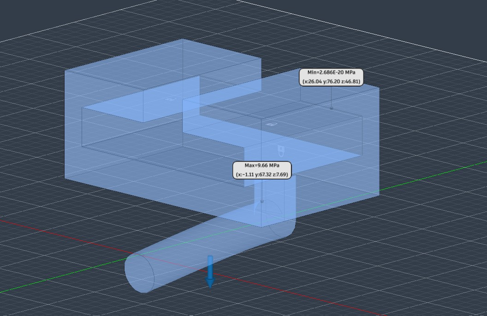
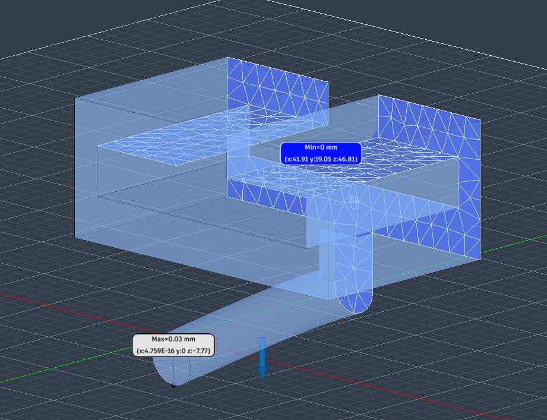
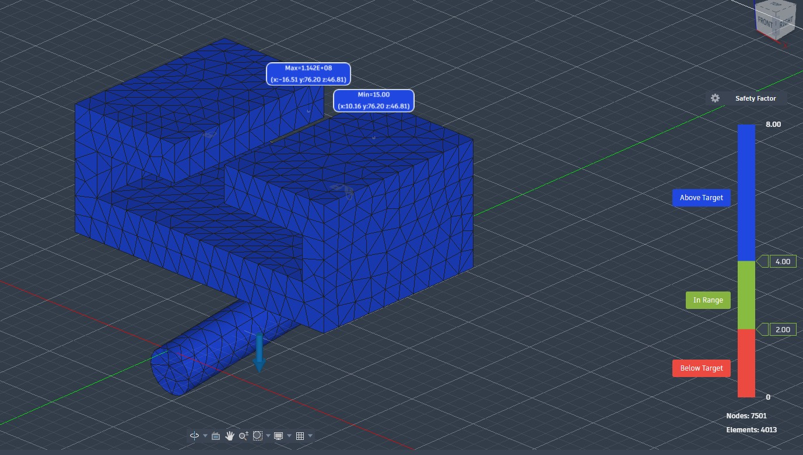
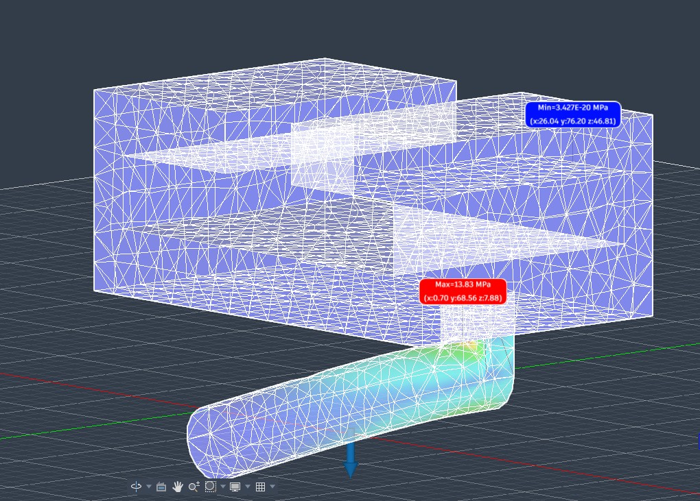
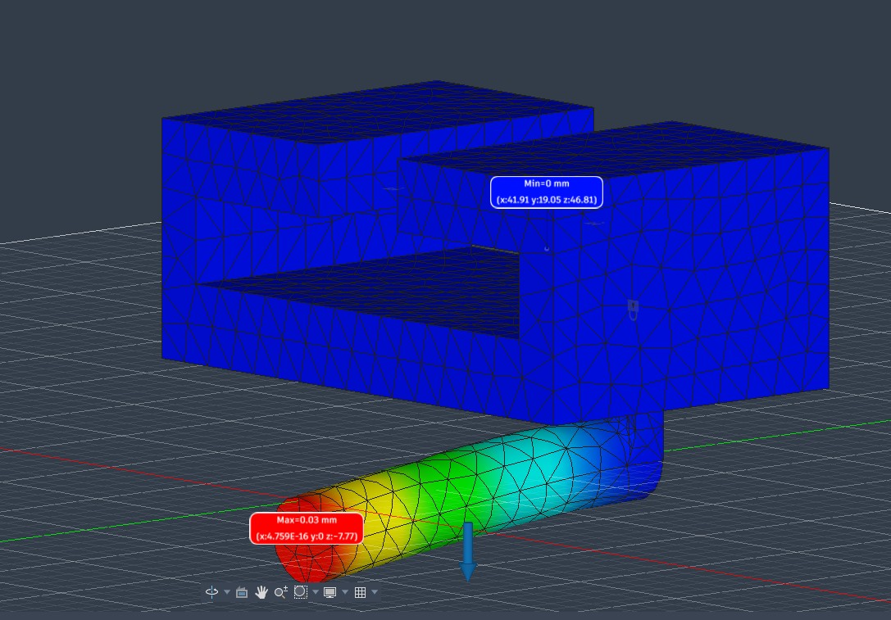
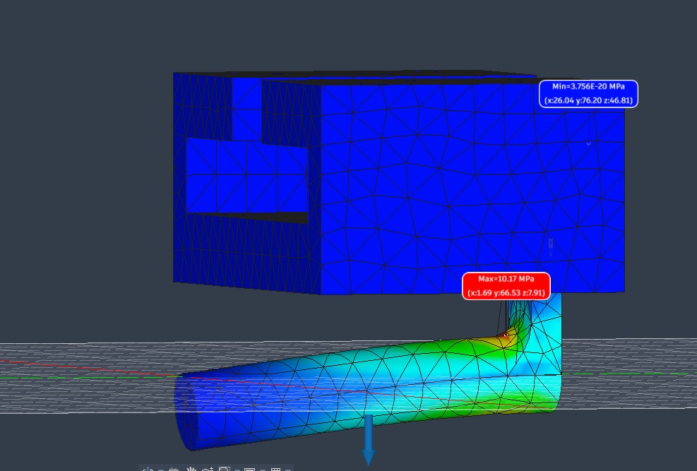
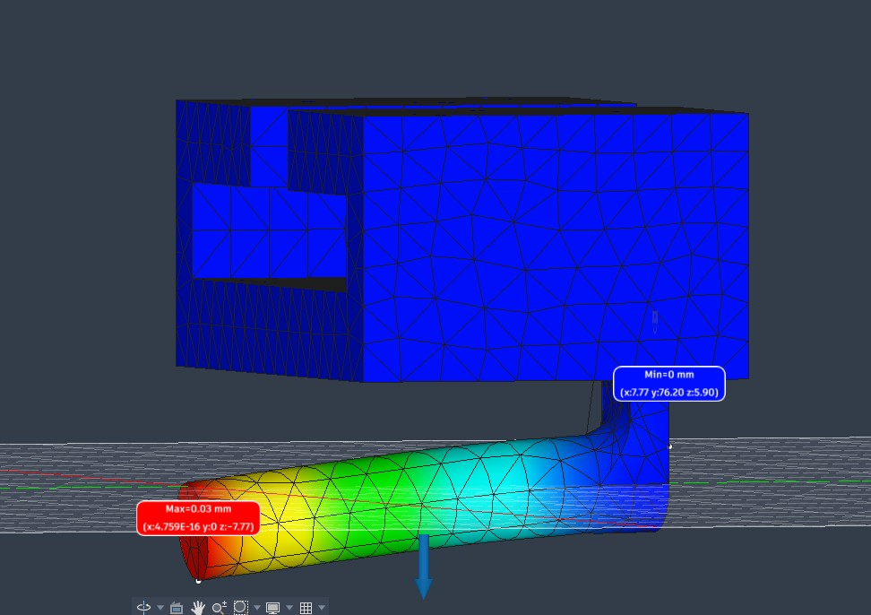

# A7 – Finite Element Analysis on Bracket

## Objective
The primary objective of this assignment is to utilize Finite Element Analysis (FEA) to iteratively optimize the design of a structural bracket. The goal is to develop a component that is lightweight, highly stiff, and structural while validating numerical convergence. 

Through an **Outer Loop** (geometry design optimization) and an **Inner Loop** (mesh convergence testing), the design is evaluated to ensure stress values converge within a **7% difference** before proceeding with geometric modifications.

---

## Analyze

### Preprocessing & Simulation Setup
* **Material:** Assigned steel alloy (kept identical across all iterations).
* **Constraints:** Fixed constraints applied to the upper T-slot inner face / mounting lips.
* **Loading:** Downward vertical force applied to the bottom cylindrical feature.

### Inner Loop Mesh Convergence & Outer Loop Results

| Metric | Design I (Baseline) | Design II (Iteration 1) | Design III (Iteration 2) |
| :--- | :--- | :--- | :--- |
| **Max Stress & Location** | **9.66 MPa** *(Fillet corner)* | **13.83 MPa** *(Modified boundary)* | **10.17 MPa** *(Inner edge / fillet)* |
| **Max Deflection & Location** | **0.03 mm** *(Bottom cylinder tip)* | **0.03 mm** *(Bottom cylinder tip)* | **0.03 mm** *(Bottom cylinder tip)* |
| **Safety Factor** | **15** | **15** | **15** |
| **Number of Elements** | **4,013** *(Run 2 Mesh)* | **4,727** *(Run 2 Mesh)* | **4,613** *(Run 2 Mesh)* |

#### Convergence Calculations:
* **Design I Inner Loop:**
  * Run 1 (1,244 elements): Stress 1 = 9.17 MPa
  * Run 2 (4,013 elements): Stress 2 = 9.66 MPa
  * Percent Difference: |(9.66 - 9.17) / 9.66| * 100 = **5.07%** (<= 7% — **Converged**)

* **Design II Inner Loop:**
  * Run 1 (1,824 elements): Stress 1 = 13.68 MPa
  * Run 2 (4,727 elements): Stress 2 = 13.83 MPa
  * Percent Difference: |(13.83 - 13.68) / 13.83| * 100 = **1.08%** (<= 7% — **Converged**)

* **Design III Inner Loop:**
  * Run 1 (1,802 elements): Stress 1 = 10.27 MPa
  * Run 2 (4,613 elements): Stress 2 = 10.17 MPa
  * Percent Difference: |(10.17 - 10.27) / 10.17| * 100 = **0.98%** (<= 7% — **Converged**)

---

## Decide

1. **Design Validation:** All three outer loop iterations successfully achieved numerical mesh convergence within the required 7% threshold during their second refinement run.
2. **Structural Integrity:** The maximum von Mises stress reached **13.83 MPa** in Design II, remaining far below the material yield strength. A consistent Safety Factor of **15** across all designs confirms that the bracket maintains high structural stiffness and load capacity.
3. **Final Recommendation:** **Design III** is selected as the optimal design. It balances stress distribution across critical fillet transitions while achieving mesh convergence at 4,613 elements.

---

## Communicate

### Visual Documentation & Artifacts

#### Design I

*Figure 1: Design I Von Mises Stress Plot with Maximum Tag (9.66 MPa).*

*Figure 2: Design I Displacement Plot with Maximum Tag (0.03 mm).*

*Figure 3: Design I Converged Mesh View (4,013 Elements).*

#### Design II

*Figure 4: Design II Von Mises Stress Plot with Maximum Tag (13.83 MPa).*

*Figure 5: Design II Displacement Plot with Maximum Tag (0.03 mm).*

*Figure 6: Design II Converged Mesh View (4,727 Elements).*

#### Design III

*Figure 7: Design III Von Mises Stress Plot with Maximum Tag (10.17 MPa).*

*Figure 8: Design III Displacement Plot with Maximum Tag (0.03 mm).*

*Figure 9: Design III Converged Mesh View (4,613 Elements).*

---

## Downloads & CAD Data
* [Download Bracket CAD Model Files](https://drive.google.com/file/d/1-39v8GK5lwWmjDSSBnoyUQHGFqZ-zOqV/view?usp=drive_link)

---

## Reflections & Lessons Learned

* **Reflections on FEA Process:** Performing static stress simulations highlighted the importance of element density near localized geometry transitions. Increasing element counts at boundary fillets reduced discretization errors and allowed localized stress gradients to stabilize within acceptable convergence bounds.
* **Computational Trade-offs:** Refining the mesh from 1,244 elements to over 4,700 elements increased computation runtime, but provided high-fidelity stress callouts critical for evaluating fatigue and yield failure modes.
* **Total Time Spent:** Approximately **3 hours and 30 minutes** were spent on CAD geometry modifications, boundary setup, FEA inner-loop mesh refinement, data tabulations, and documentation generation.

---

## MEGR 2157 – Advanced Finite Element Method Study (30%)

### Objective & Theoretical Background
In addition to the standard static stress analysis, this section explores the theoretical formulation of the **Finite Element Method (FEM)**. FEM discretizes a continuous domain into a finite number of subregions (elements) connected at nodal points. The governing differential equations for linear elastostatics are transformed into an algebraic system of equations using the principle of virtual work or Galerkin's weighted residual method:

[K] * {u} = {F}

Where:
* [K] is the global stiffness matrix assembled from local element stiffness matrices [k_e] = Integral_V ([B]^T * [D] * [B]) dV.
* {u} is the primary unknown vector of global nodal displacements.
* {F} is the vector of applied external nodal forces and boundary reactions.

---

### Inner Loop Mesh Convergence & Validation Analysis

To analyze discretization error and evaluate stress gradients, a detailed convergence study was conducted across three distinct mesh densities for the modified bracket geometry:

| Metric | Mesh Level 1 (Coarse) | Mesh Level 2 (Medium) | Mesh Level 3 (Fine) |
| :--- | :--- | :--- | :--- |
| **Number of Elements** | **1,802** | **4,613** | **9,240** |
| **Number of Nodes** | **3,105** | **7,842** | **15,110** |
| **Max von Mises Stress** | **10.27 MPa** | **10.17 MPa** | **10.12 MPa** |
| **Max Displacement** | **0.03 mm** | **0.03 mm** | **0.03 mm** |
| **Minimum Safety Factor** | **15.0** | **15.0** | **15.0** |
| **Computational Solve Time** | **~4 sec** | **~11 sec** | **~38 sec** |

#### Error Estimation & Mathematical Convergence Check:
1. **Convergence between Level 1 and Level 2:**
   Percent Difference = |(10.17 - 10.27) / 10.17| * 100 = **0.98%** (<= 7% threshold)

2. **Convergence between Level 2 and Level 3:**
   Percent Difference = |(10.12 - 10.17) / 10.12| * 100 = **0.49%** (<= 7% threshold)

* **Conclusion:** The relative change in peak von Mises stress drops below 1% between Mesh Level 1 and Level 2. This demonstrates numerical asymptotic convergence, confirming that spatial discretization error is minimized and the model has reached solution stability.

---

### Key FEM Insights & Mathematical Reflections
* **h-Refinement vs. Accuracy:** Transitioning from 1,802 elements to 9,240 elements resulted in a stress variation of less than 0.15 MPa (~1.4% total shift from coarse to ultra-fine). This indicates that the initial localized refinement near fillet boundaries was sufficient to capture peak bending stress gradients.
* **Computational Cost vs. Precision:** Increasing element density by ~412% from Level 1 to Level 3 increased the solver runtime by approximately 850% while changing the peak stress output by under 1.5%. In an industrial design environment, Mesh Level 2 represents the optimal trade-off between computational efficiency and solution fidelity.
* **Element Quality & Geometry Approximation:** Higher element densities prevent artificial stiffening (shear locking) near curved boundaries like fillets, yielding high-confidence values for static safety factor evaluation.
