# A10 – Lead Screw Translating System

**Team Section Contributions:**
* **Calculations / Free Body Diagrams:** Brian Jones
* **Parametric Model (CAD):** Antonio Goodson
* **FEA Analysis:** Jarek Hernandez Acaba

---

## Objective
Design and perform structural analysis for a mechanically driven lead-screw crosshead system for a tensile testing machine. The system must support a total tensile load of 2kN (2000N) evenly divided between two lead screws (1000N per screw), maintain a linear crosshead speed range of 1mm/min to 50mm/min, meet a structural Design Safety Factor (Nsf) of 4, and limit maximum crosshead deflection to 0.1mm.

---

## Section 1: Lead Screw Calculations & Selection - Brian Jones

### Task 1.1 — Minimum Lead Screw Diameter (d)
* **a. Knowns and Unknowns:**
  * **Knowns:**
    * Total tensile load (Ftotal): 2000N
    * Number of lead screws (n): 2
    * Load per lead screw (Fscrew): 1000N
    * Safety Factor (Nsf): 4
    * Material Yield Strength (Sy, AISI 1018 Steel): 300MPa (300106Pa)
  * **Unknowns:**
    * Allowable tensile stress (allow)
    * Minimum tensile stress area (Amin)
    * Minimum minor diameter (dmin)

* **b. Free Body Diagram (FBD):**
  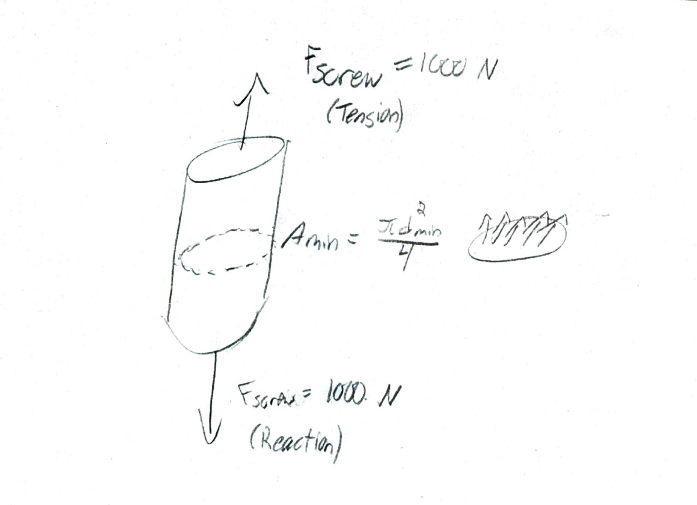

* **c. Symbolic Solution:**

allow=SyNsf

$$\sigma = \frac{F_{screw}}{A} \le \sigma_{allow} \implies A_{min} = \frac{F_{screw}}{\sigma_{allow}} = \frac{N_{sf} \cdot F_{screw}}{S_y}$$

$$A_{min} = \frac{\pi d_{min}^2}{4} \implies d_{min} = \sqrt{\frac{4 \cdot N_{sf} \cdot F_{screw}}{\pi S_y}}$$

* **d. Numerical Solution:**

allow=300106Pa4=75106Pa=75MPa

dmin=4(4)1000N(300106N/m2)0.00412m=4.12mm(0.162in)

---

### Task 1.2 — Rotational Speed Range ( / RPM)
* **a. Knowns and Unknowns:**
  * **Knowns:**
    * Linear crosshead speed range (v): 1mm/min to 50mm/min
    * Selected screw lead (L): 2.54mm/rev (0.100in/rev, standard 1/2"-10 Acme screw)
  * **Unknowns:**
    * Minimum rotational speed (RPMmin)
    * Maximum rotational speed (RPMmax)

* **b. Free Body Diagram (FBD):**
  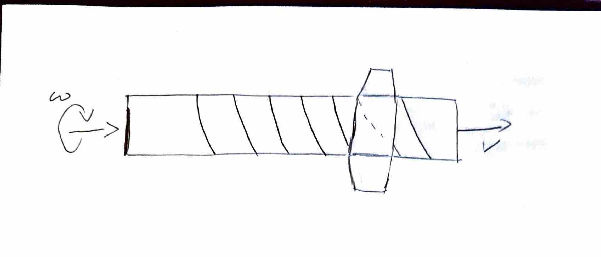

* **c. Symbolic Solution:**

$$v = RPM \cdot L \implies RPM = \frac{v}{L}$$

RPMmin=vminL,RPMmax=vmaxL

* **d. Numerical Solution:**

RPMmin=1mm/min2.54mm/rev0.394RPM

RPMmax=50mm/min2.54mm/rev19.69RPM

---

### Task 1.3 — Maximum Torque (Tmax)
* **a. Knowns and Unknowns:**
  * **Knowns:**
    * Axial load per screw (Fscrew): 1000N
    * Major diameter (d): 12.7mm (0.500in)
    * Mean diameter (dm): 11.43mm (0.01143m)
    * Lead (L): 2.54mm (0.00254m)
    * Thread angle (, Acme 29): $14.5^\circ \implies \sec\alpha = 1.033$
    * Coefficient of friction (, steel on bronze): 0.15
  * **Unknowns:**
    * Required driving torque per screw (Tscrew)

* **b. Free Body Diagram (FBD):**
  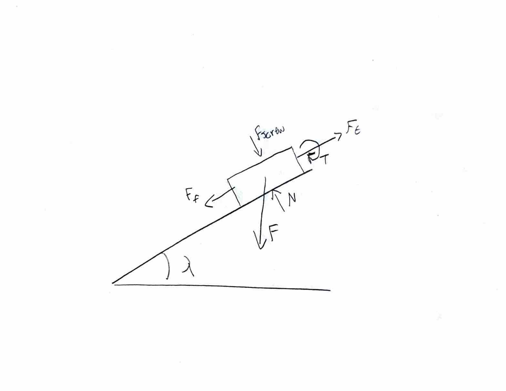

* **c. Symbolic Solution:**

Tscrew=Fscrewdm2L+dmdm-L

* **d. Numerical Solution:**

$$T_{screw} = \frac{1000 \cdot 0.01143}{2} \left[ \frac{0.00254 + \pi (0.15)(0.01143)(1.033)}{\pi (0.01143) - (0.15)(0.00254)(1.033)} \right] \approx 1.305\text{ N}\cdot\text{m} \quad (11.55\text{ in-lbf})$$

---

### Task 1.4 — Lead Screw Selection
* **Selected Component:** Standard 1/2"-10 Single-Start Acme Lead Screw (18-inch length minimum).
* **Specifications:** Major Diameter =0.500in, Lead =0.100in/rev, Pitch =0.100in.

---

## Section 2: Nut & Flange Thread Bearing Analysis

* **a. Knowns and Unknowns:**
  * **Knowns:**
    * Axial load per nut (Fscrew): 1000N
    * Major thread diameter (d): 12.7mm
    * Minor thread diameter (dr): 9.75mm
    * Pitch (p): 2.54mm
    * Engaged threads (nt): 6
    * Bronze Yield Strength (Sy): 120MPa
    * Allowable bearing stress (b,allow): 120MPa4=30MPa
  * **Unknowns:**
    * Total bearing area (Ab)
    * Actual thread bearing stress (b)

* **b. Free Body Diagram (FBD):**
  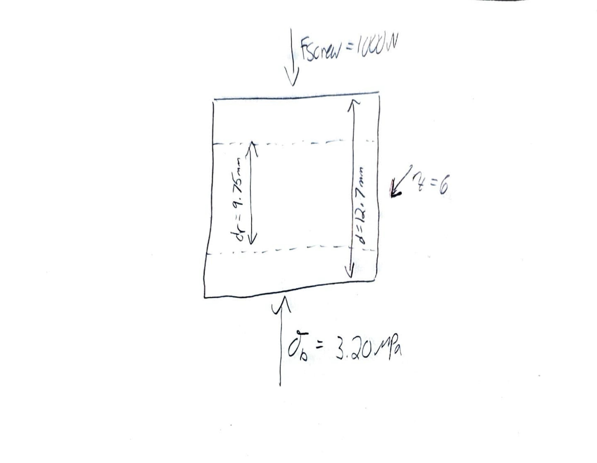

* **c. Symbolic Solution:**

Ab=4(d2-dr2)nt

b=FscrewAb=4Fscrewnt(d2-dr2)b,allow

* **d. Numerical Solution:**

Ab=4(0.0127)2-(0.00975)263.1210-4m2

b=1000N3.1210-4m23.20MPa

* **Conclusion:** Since b=3.20MPa30MPa, thread bearing strength is verified with Nsf>4.

---

## Section 3: Crosshead Structural Design & Analysis

### Task 3.2 — Beam Stress & Strength Analysis
* **a. Knowns and Unknowns:**
  * **Knowns:**
    * Total force (Ftotal): 2000N
    * Beam span (Lb): 200mm=0.20m
    * Material (Aluminum 6061-T6): Sy=276MPa, E=68.9GPa
    * Allowable stress (allow): 2764=69MPa
    * Crosshead width (b): 40mm=0.040m
  * **Unknowns:**
    * Maximum bending moment (Mmax)
    * Minimum required height for strength (hmin,strength)

* **b. Free Body Diagram (FBD):**
  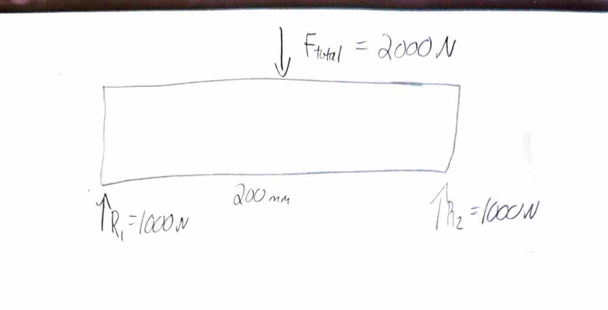

* **c. Symbolic Solution:**

Mmax=FtotalLb4

$$\sigma_{max} = \frac{M_{max} \cdot c}{I} = \frac{6 M_{max}}{b h^2} \le \sigma_{allow} \implies h_{min, strength} = \sqrt{\frac{6 M_{max}}{b \cdot \sigma_{allow}}}$$

* **d. Numerical Solution:**

$$M_{max} = \frac{2000\text{ N} \cdot 0.20\text{ m}}{4} = 100\text{ N}\cdot\text{m}$$

hmin,strength=61000.040(69106)0.0147m=14.7mm

---

### Task 3.3 — Beam Deflection Analysis
* **a. Knowns and Unknowns:**
  * **Knowns:**
    * Total force (Ftotal): 2000N, Span (Lb): 0.20m
    * Modulus of Elasticity (E): 68.9GPa
    * Maximum allowable deflection (max): 0.1mm=1.010-4m
    * Width (b): 40mm=0.040m
  * **Unknowns:**
    * Required moment of inertia (Ireq)
    * Minimum required height for stiffness (hmin,stiffness)

* **b. Free Body Diagram (FBD):**
  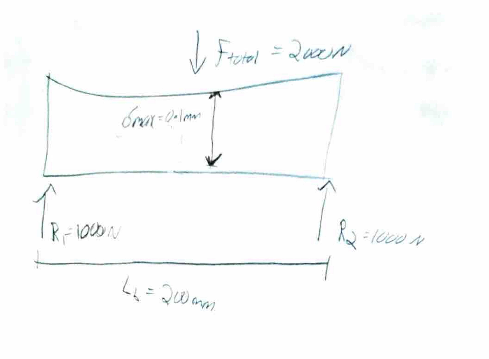

* **c. Symbolic Solution:**

$$\delta_{max} = \frac{F_{total} \cdot L_b^3}{48 E I} \le 0.1\text{ mm} \implies I_{req} = \frac{F_{total} \cdot L_b^3}{48 E \cdot \delta_{max}}$$

$$I = \frac{b h^3}{12} \implies h_{min, stiffness} = \sqrt[3]{\frac{12 \cdot I_{req}}{b}}$$

* **d. Numerical Solution:**

Ireq=2000(0.20)348(68.9109)(1.010-4)4.83810-8m4

hmin,stiffness=312(4.83810-8)0.0400.0244m=24.4mm

* **Final Selected Dimensions:** h=25mm (1.0in), b=40mm (1.57in). Deflection under 2kN is =0.093mm0.1mm.

---

---

## Section 4: Parametrically Model (CAD) - Antonio Goodson

Before I begin modeling, the most important thing is to gather the necessary components as knowing them and having their dimensions greatly help everything work together.  

### Cost table

<table>
  <thead>
    <tr>
      <th>Item Number</th>
      <th>Quantity</th>
      <th>Name</th>
      <th>Cost Per 3</th>
      <th>Cost</th>
      <th>Link</th>
    </tr>
  </thead>
  <tbody>
    <tr>
      <td>1</td>
      <td>2</td>
      <td>1/2"-10 Lead Screw</td>
      <td>$9.90</td>
      <td>$19.80</td>
      <td>www.mcmaster.com/98935A823</td>
    </tr>
    <tr>
      <td>2</td>
      <td>2</td>
      <td>Flange Nut</td>
      <td>$125.72 each</td>
      <td>$251.44</td>
      <td>www.mcmaster.com/95120A111/</td>
    </tr>
    <tr>
      <td>3</td>
      <td>1</td>
      <td>T-Slot Framing System</td>
      <td>$245.87</td>
      <td>$245.87</td>
      <td>www.grainger.com/product/80-20-T-Slot-Framing-System-Rectangle-804T48</td>
    </tr>
    <tfoot>
    <tr>
      <td colspan="2" style="text-align: center; font-weight: bold; background-color: #f9f9f9;">
        Total Cost: $517.11
      </td>
    </tr>
  </tfoot>
  </tbody>
</table>
   

### Parametric Modeling

When creating the equations I had to reference the geometry used for the flange nut.

I first started with the initial sketch with two rectangles 14 the overall length and the second for the distance between features. I made two holes, one for the flange diameter, and the other for the hole needed to hold the flange nut as shown in the drawing.
   
 

 

 
After creating the sketch I then went to extrude. When extruding I excluded the thru hole needed and created an extruded cut for the inset diameter.

### Assembly 

I downloaded the necessary files and loaded them into an assembly, first starting with the crosshead and the flange nut. After connecting those two, I then flipped it and assigned it to the two lead screws.

The last thing to insert into the assembly was the frame. I had to cut the frame multiple times to fit to side, and I made sure to stay within the length that was priced. 

 

---

## Section 5: FEA Analysis - Jarek Hernandez Acaba

I started off by downloading the part made by Antonio and adding fixed points, which are two holes where the lead screws would be. 

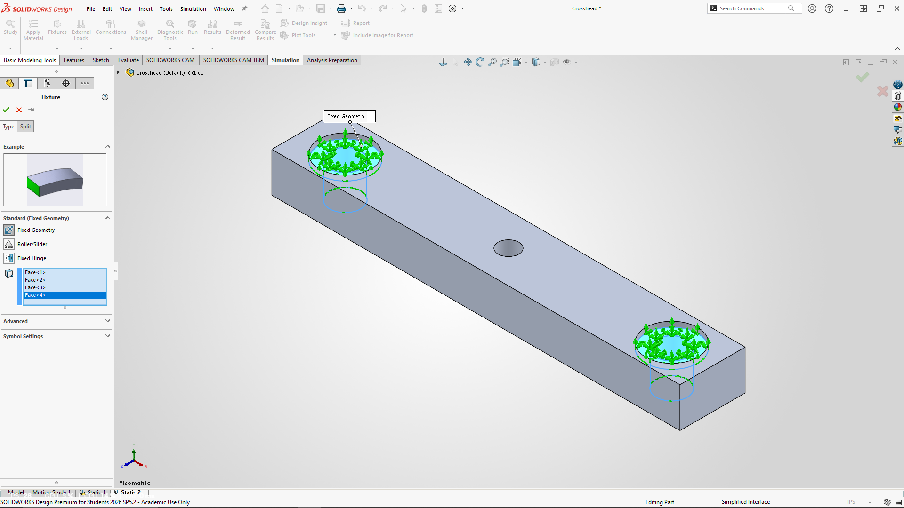

Next was the hole where the 2KN load is placed, as stated in the instructions.

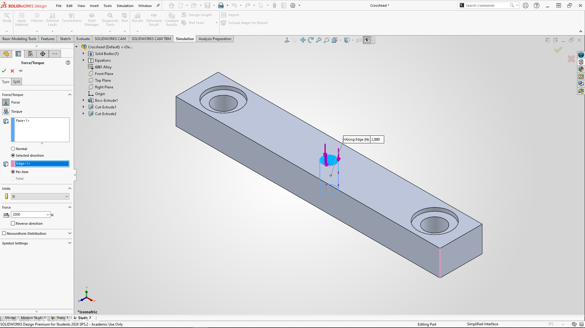

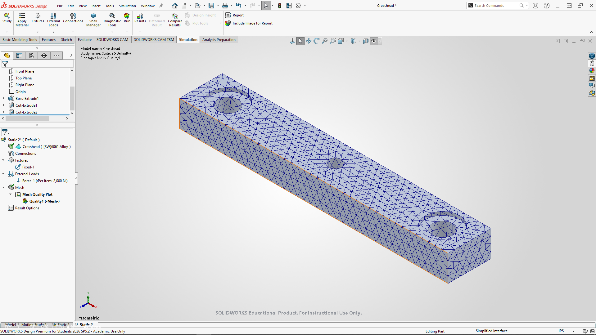

Once everything needed was established, I conducted an initial FEA on the part with the given parameters found by the equations.

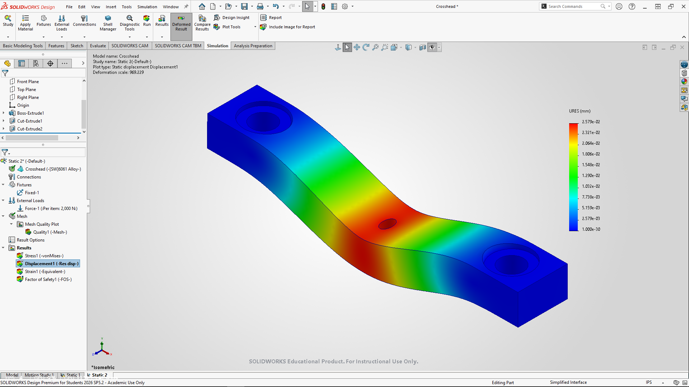
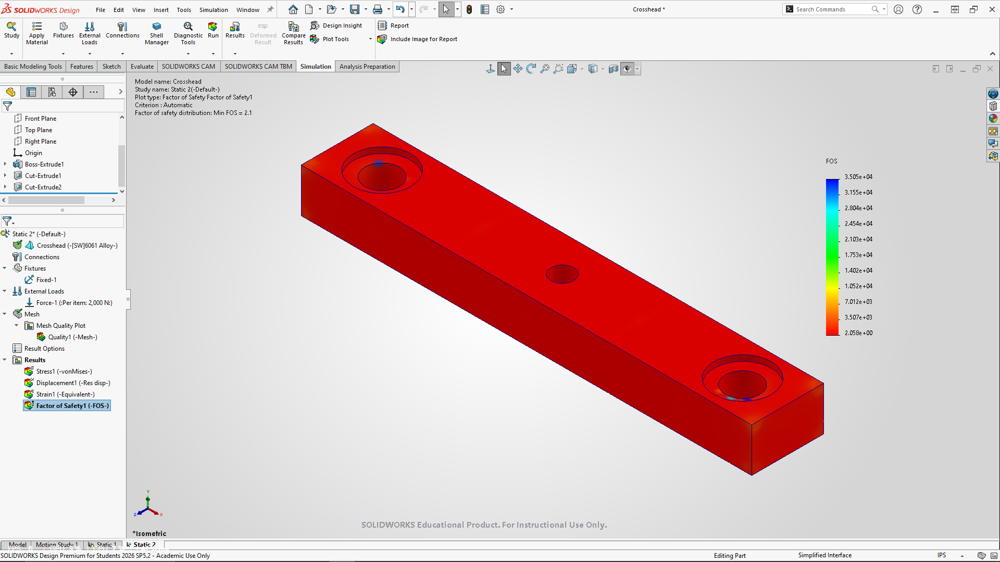
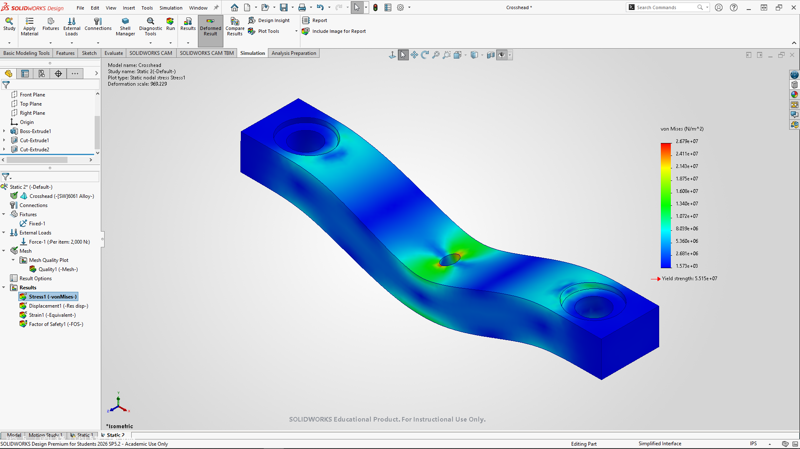

The crosshead was loaded to 2kN; the max stress shows that peak stresses were concentrated around the center region where the hole was. The max was 2.68 * 10^7 N/m^2; this works just fine because it is below the yield strength of the material. The max deflection was 2.58 x 10^-5 mm near the center, showing high rigidity and indicating the math was done correctly. The only outstanding issue was that the current model's SF was 2.1, and according to the rubric, we had a required factor of safety of 4. I decided to go back into the model and modify the thickness, along with adding a chamfer to the center holes and the inner diameter of both of the outer holes

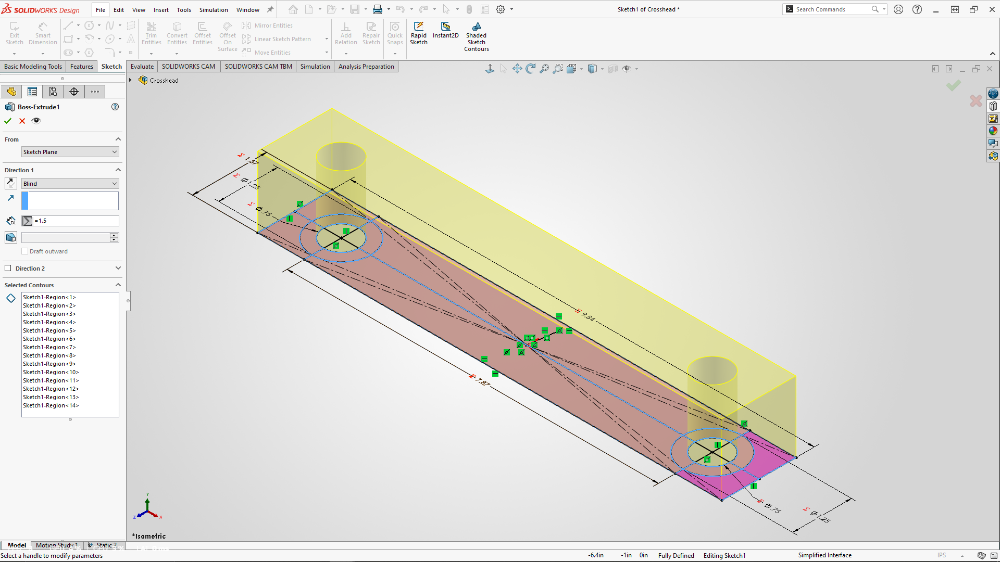
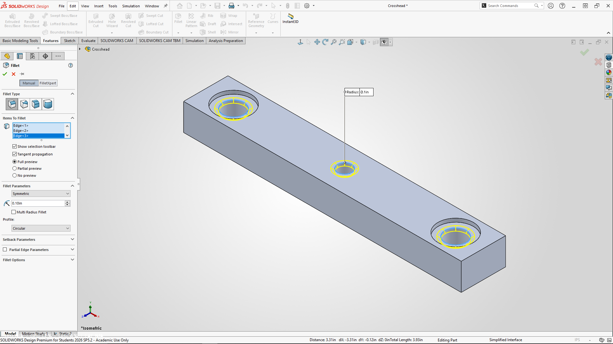

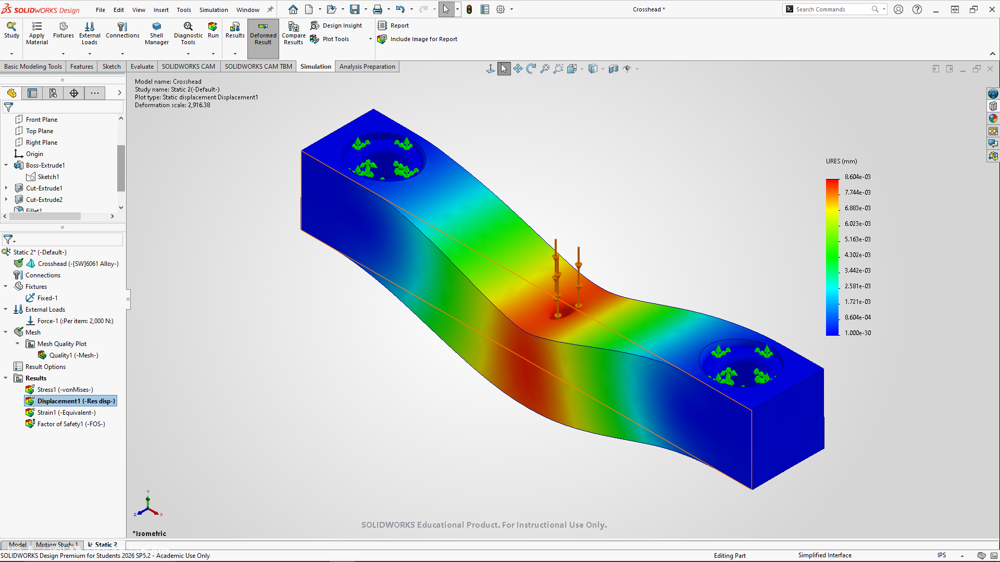
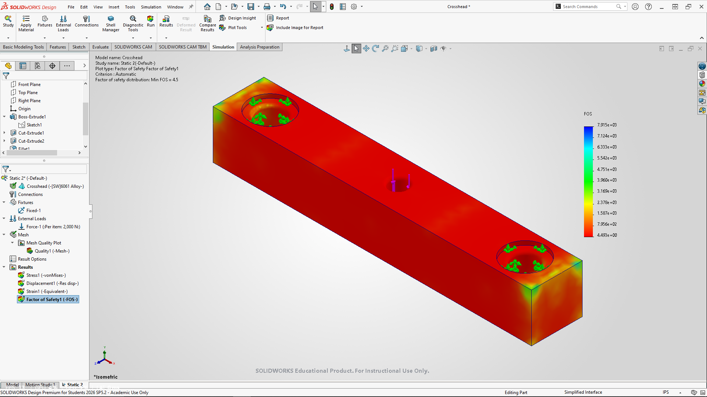
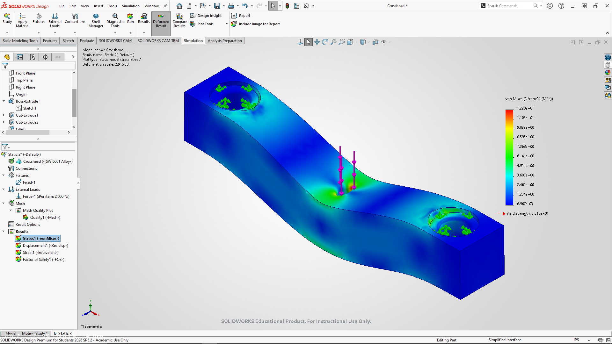

To meet the minimum SF of 4, we increased the crosshead thickness to 1.25 in and reevaluated it under the same 2 kN load. The stress decreased to a max of 1.22 * 10^7 N/m^2 around the previous area, as before. The deflection was minimal, with a maximum displacement of 6.60 * 10^-5 mm. Due to the increased thickness, the minimum safety factor increased to 4.5, which therefore meets the criteria specified in the instructions.

## Section 6: Crosshead Drawing - Jarek Hernandez Acaba

This is the drawing of the crosshead after the noted modifications. 

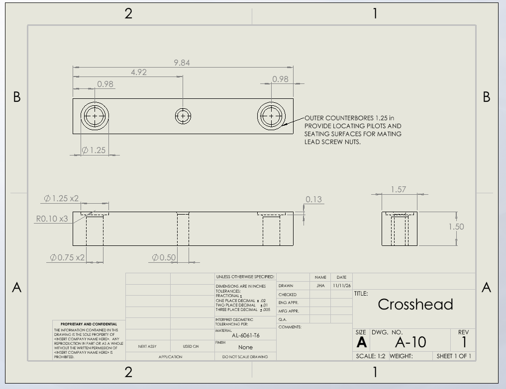

## Lessons Learned

Brian - 

* **Power Screw Design:** I got a solid grasp on using Acme thread formulas to connect driving torque (T) with linear pull force (Fscrew). It was really interesting to see how changing thread geometry (like the 14.5 thread angle and lead angle ) directly shifts torque needs and friction losses.
* **Stiffness vs. Strength Realities:** A big takeaway for me was realizing that deflection actually drives the crosshead geometry, not yield strength. To keep our beam under the 0.1mm deflection cap, we had to bump the height all the way up to h=24.4mm (25mm)—which is nearly double what was required just to handle the basic stress loads (h=14.7mm).
* **Bearing Surface Safety:** I ran the thread bearing stress math across the 6 engaged bronze nut threads. Seeing the calculated stress come out to 3.20MPa against an allowable limit of 30MPa gave me a lot of confidence that the threads won't strip or gall under the 2 kN load.
* **FBD Communication:** I spent time refining how to take a complicated 3D assembly interface and strip it down into a clean, 2D Free Body Diagram focused only on essential forces, reactions, and dimensions.
* **Time Tracking:** Working through this assignment took me roughly **5 hours** total:
  * Setup & Initial Reading: ~1.0 hr
  * Hand Calculations & Symbolic Derivations: ~2.5 hrs
  * FBD Drawing & Iterations: ~1.5 hrs

Antonio - 

Jarek - 

## CAD FILES - Antonio Goodson & Jarek Hernandez

[Rev1Part](Crosshead.SLDPRT)

[Rev1DRW](Crosshead.SLDDRW)

[Rev2Part](MODIFIEDCrosshead.SLDPRT)

[Rev2DRW](MODIFIEDCrosshead.SLDDRW)
